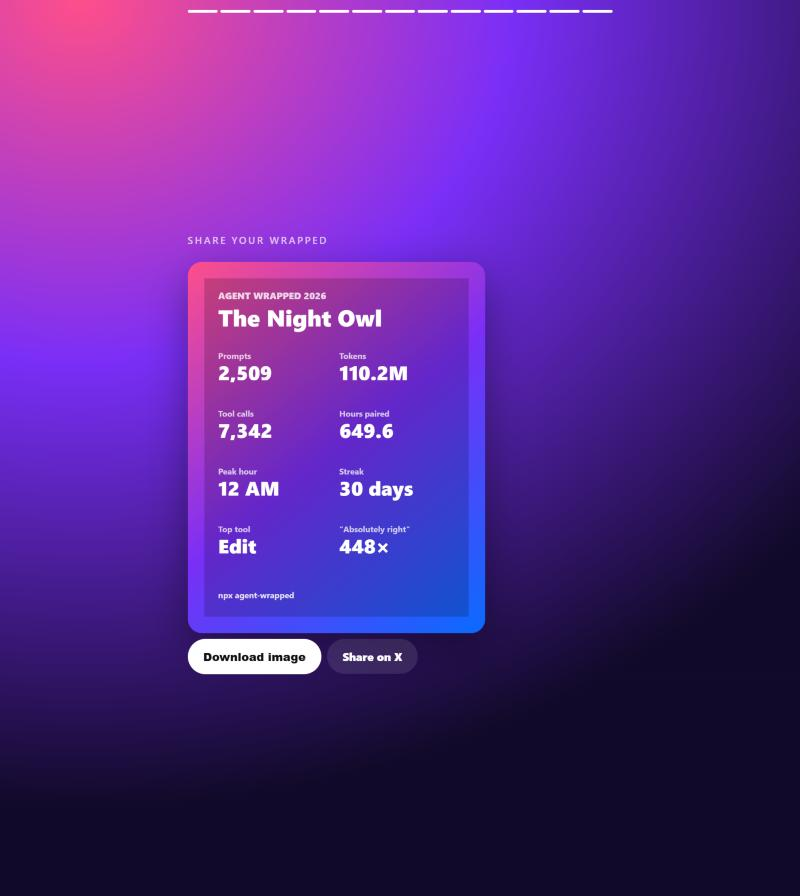
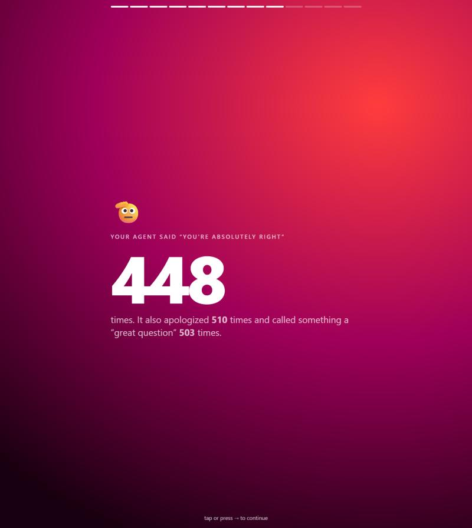

<div align="center">

# 🎁 agent-wrapped

**Spotify Wrapped, but for your AI coding agent.**

How many tokens did you burn this year? Which file did you edit 300 times?<br>
And how many times did your agent tell you *"You're absolutely right"*?

```bash
npx agent-wrapped
```

Works with **Claude Code** and **Codex**. Zero dependencies. 100% local, nothing leaves your machine.



</div>

---

## What you get

A full-screen, tap-through story (like the one you get from your music app) built from your local agent transcripts:

| | |
|---|---|
|  |  |

- 💬 **Prompts, sessions, hours actually paired** with your agent
- 🔥 **Tokens burned** (and how many *War and Peace*s that is)
- 🛠️ **Favorite tools** and **terminal greatest hits**
- 📄 **The file you couldn't leave alone**
- 🌙 **Peak hour**, busiest weekday, longest streak, activity heatmap
- 🫡 **"You're absolutely right" counter**, apologies, "great question"s
- 🙏 **Your manners report**: please, thanks, interruptions, "why", CAPS LOCK
- 🧬 **Your agent personality**: The Night Owl, The Backseat Driver, The Diplomat, The Delegator, The Shouter, The Streaker...
- 🖼️ **A share card** you can download as a PNG or post straight to X

## Usage

```bash
npx agent-wrapped              # last 365 days, opens in your browser
npx agent-wrapped --year 2026  # one calendar year
npx agent-wrapped --all        # your entire history
npx agent-wrapped --json       # raw stats, pipe it anywhere
```

| Option | |
|---|---|
| `--year <yyyy>` | Only this calendar year |
| `--all` | Whole history |
| `--since <date>` / `--until <date>` | Custom range |
| `--dir <path>` | Read transcripts from a custom folder (repeatable) |
| `--out <file>` | Output file (default `./agent-wrapped.html`) |
| `--json` | Print stats as JSON |
| `--no-open` | Don't open the browser |

## Where the data comes from

| Agent | Folder |
|---|---|
| Claude Code | `~/.claude/projects/**/*.jsonl` (respects `CLAUDE_CONFIG_DIR`) |
| Codex CLI | `~/.codex/sessions/**/*.jsonl` (respects `CODEX_HOME`) |

## Privacy

- No network requests. No telemetry. No dependencies to audit.
- The output is a single self-contained HTML file. It contains only aggregate numbers, top file *names* and project folder names, never your prompts or code.
- Check the top lists before you share the card if your file or project names are secret.

## Try it without your own data

```bash
git clone https://github.com/alwaan-pro/agent-wrapped
cd agent-wrapped
npm run fixtures && npm run demo
```

## Contributing

Want support for Cursor, Gemini CLI, Aider, OpenCode or another agent? Add a parser in [`src/parse.js`](src/parse.js) that returns the normalized event shape, plus a fixture in `test/make-fixtures.js`. New personas and fun stats are very welcome too: see `persona()` in [`src/stats.js`](src/stats.js).

```bash
npm test
```

## Share yours

Post your card with **#AgentWrapped**. If this made you laugh, a ⭐ helps other people find it.

## License

MIT
